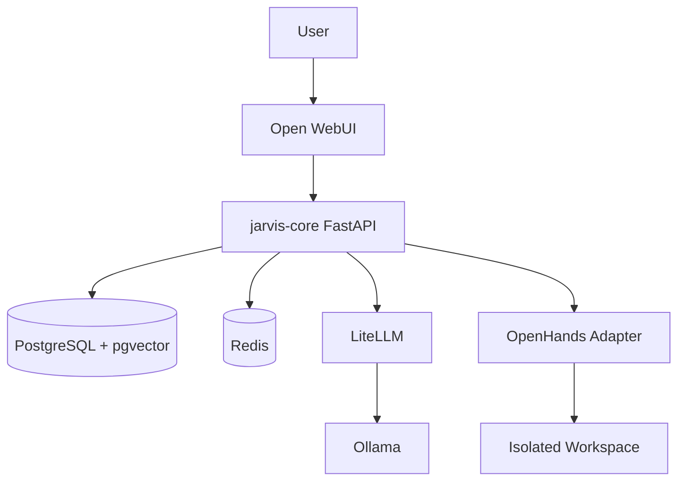

# Architecture

## رویکرد

Compose همه سرویس‌ها را روی شبکه داخلی `jarvis` و با volumeهای نام‌دار اجرا می‌کند. هسته، interfaceهای کوچک دارد تا برای CI به‌صورت مستقل تست شود و در production به PostgreSQL/Redis/OpenHands متصل گردد.
